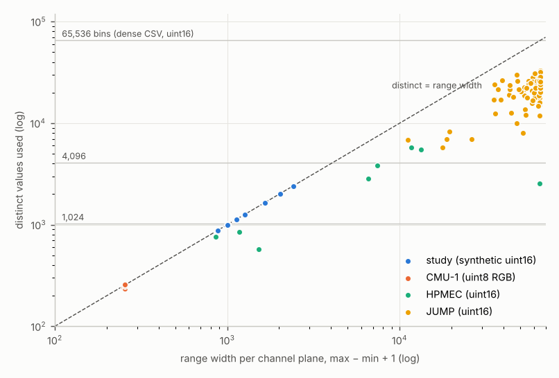
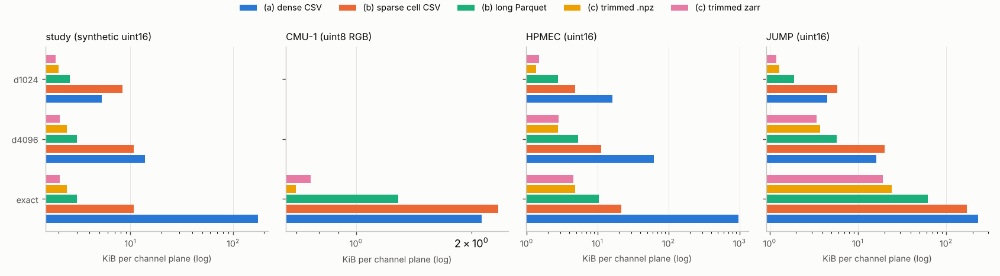

# Histogram storage and bin count (study D9, November 2026; not for merge)

**Question (owner):** `plane_histograms.csv` (schema v5, ADR 0003) gives an integer plane one
column per possible value: 65,536 bins per uint16 channel, a 131,110-column header for two
channels. Do we need so many bins, and is there a more efficient format?

**Short answer.**

- **Keep the exact bins. Change how they are stored.** The 65,536 bins cost nothing in memory
  or pooling; what costs is writing 65,536 text cells per channel, almost all zero. On the
  real 16-bit data, a plane uses 4 % (HPMEC) to 34 % (JUMP) of its bins.
- **Exact, sparse or trimmed storage keeps every number bit for bit.** Every format below
  was read back to the same `PlaneRecord`s, and every parameter, summary and warning came
  out bit-identical (0 differences in 6,515 numbers × 4 formats).
- **Coarse bins (4,096 or 1,024) change results that users see.** They make no difference on
  the synthetic data alone, whose planes span fewer than 4,096 values. On the real 16-bit
  data they change decisions:
  - 32 of 90 JUMP saturated fractions become blank (not decidable);
  - every fitted group is flagged `normalization_exact = false`;
  - robust z-score scales are off by up to 6.7 % (JUMP, 4,096 bins) and 60 % (HPMEC,
    4,096 bins);
  - one robust z-score fit is refused (MAD = 0) at 1,024 bins;
  - one new `repeat_intensity_shift` warning appears on JUMP at 1,024 bins.
- **Recommendation: schema v6 = v5 with one sparse `Histogram_Counts_<ID>` cell per channel.**
  The cell uses ADR 0004's sparse grammar, `index:count;…`, which `window_histograms.csv`
  already uses.
  - It needs no new dependency and keeps one row per plane (HV1).
  - It is 16× (study) to 44× (HPMEC) smaller and 12× to 27× faster to write.
  - Its weak case is full-range 16-bit data (JUMP): only 1.4× smaller and 1.4× faster.
  - Long Parquet would be the stronger format there (3.8× smaller, 3.5× faster write), at the
    cost of a 170 MB pyarrow dependency in the core bricks.

Base: normalization `main` at `9616e12` (v0.7.0 + #104), unchanged; nothing in `src/` was
modified. Every histogram, parameter and decision below comes from this repository's own
functions.

## Machine, versions and rules

- Linux x86_64, 4 CPUs, about 15 GB, **shared**: the 1-minute load average was 2.2 to 4.6
  during the I/O runs.
- One heavy job at a time. Every I/O operation ran in a fresh process: a warm-up, then
  5 timed repeats (3 for the per-image runs). Each figure is the median, with the min–max in
  `results.md`.
- Python 3.13.18, NumPy 2.5.5, pyarrow 26.0.1, zarr 3.4.2, tifffile 2026.11.12, imagecodecs
  2026.11.11, matplotlib 3.11.2.
- Commits read:

| Repository | Commit |
| --- | --- |
| normalization | `9616e12` |
| preprocessing | `ce650e3` (main); `f9c6975` (PR #318 study) |
| MorphoBricks-Spec | `1167108` |
| CellPatcher | `e0e56bc` |
| MorphoFeature | `7ac7487` |
| MorphoRelate | `e991cd3` (data) |

## Data (about 540 MB downloaded, deleted afterwards)

| Dataset | What | Bit depth found |
| --- | --- | --- |
| **study** | PR #318's data: preprocessing `tools/benchmark_run_workers.py`, scale 1. 14 seeded images, 76 channel planes (TIFF and OME-Zarr, 2 of them read in blocks by preprocessing) | uint16, values 0–3,499: a "12-bit in 16" range, but synthetic |
| **CMU-1** | OpenSlide test data (CC0): 8 level-0 crops of 2048 × 2048 with the most tissue (`crop_cmu1.py`, origins in `crops.json`), plus `CMU-1-Small-Region.svs`. RGB, 27 channel planes | uint8 |
| **HPMEC** | MorphoRelate `data/hpmec_perfusion`: 2 fields × 4 channels, 2048 × 2048, uint16 | Used range ≤ 13,402 in 7 of 8 channels: neither 12-bit (max > 4,095) nor full 16-bit. Position 2 ch3 reaches 64,817 (a few hot pixels, 2,558 distinct values) |
| **JUMP** | cpg0016 source_4 (CC0), the plates of MorphoRelate `data/jump_target2`: 3 plates (biological repeats) × wells E08 (DMSO) and D19 (FK-866) × sites 1–3 × 5 channels, 1080 × 1080. Every file's SHA-256 was checked against MorphoRelate's `sources.csv` | **Full 16-bit**: 32 of 90 channel planes reach 65,535 |

No real **12-bit camera** set was found in the repositories. HPMEC is the closest real
partial-range set; the study data is a synthetic 12-bit range.

The study data's exact records, written with `write_plane_histograms`, are **byte-identical**
to the `plane_histograms.csv` of a real preprocessing run of the same folder (`prepare.py`).

### Distinct values: why sparse wins

| Dataset | Range width per plane, median (min–max) | Distinct values per plane, median (min–max) | Share of the 65,536 bins used |
| --- | --- | --- | ---: |
| study | 1,129 (874–2,411) | 1,123 (873–2,404) | 1.7 % |
| CMU-1 (uint8) | 256 (251–256) | 256 (236–256) | 100 % of 256 |
| HPMEC | 6,964 (856–64,718) | 2,694 (576–5,751) | 4.1 % |
| JUMP | 62,154 (11,147–65,311) | 22,326 (5,760–32,994) | 34 % |



Partial-range data (study, HPMEC) fills a few percent of the bins: a sparse or trimmed
format stores only those. JUMP spans almost the whole 16-bit range but uses only about a
third of the values inside it (its values are not contiguous). Sparse text gains least there,
and binary formats most.

## Options compared

| Code | Option | What is stored |
| --- | --- | --- |
| `csv_dense` | **(a)** today | `write_plane_histograms` / `read_plane_histogram_table` |
| `csv_sparse` | **(b)** sparse cell, CSV | v5 with the bin columns replaced by one `Histogram_Counts_<ID>` cell per channel, in ADR 0004's grammar (`index:count;…`, `empty`); stdlib only |
| `parquet_long` | **(b)** sparse long table, Parquet | (plane_id, channel, bin, count) with zero bins left out, pyarrow, zstd; plane and feature cells in the file's metadata |
| `npz_trimmed` | **(c)** trimmed dense, `.npz` | per channel plane, the counts from the first to the last occupied bin, concatenated, with start and length arrays; `np.savez_compressed` |
| `zarr_trimmed` | **(c)** trimmed dense, zarr | the same three arrays in a zarr v3 group (zstd) |
| `d4096`, `d1024` | **(d)** coarse bins | `compute_plane_histogram`'s own integer binning at 4,096 or 1,024 bins over the min–max range; `r` = the robust range (contract §1.4). Every format was also run on these |

Notes on the options:

- For exact histograms, bin `i` holds value `Histogram_BinningMin + i`. The (b) tables
  therefore store the bin index, which equals (plane, value, count) and also works for float
  and coarse histograms.
- The plane and feature cells are the CSV's exact text in every format. Only the bin counts
  change representation.
- Every reader builds the repository's `PlaneHistogram`, so every `integrity.py` invariant
  runs on read. The (b)/(c) readers are prototypes with the main structural checks (sparse
  indices increasing and in range, counts positive); they are not full v5-grade validators.
- (d) does not apply to uint8: 256 bins is the maximum, already exact.

## Results

The full tables, with min–max for every timing and every variant, are in
[`results.md`](results.md). Raw data: `io_results.json`, `accuracy.json`,
`memory_traced.json` and `gzip_probe.json`.



### Exact histograms: size and speed (median ms; KiB per channel plane)

| Dataset | Format | Total | KiB / plane | × smaller | Write | Read | Per-image files: write → +read → final write ("staging cycle") | Write, 1 → 4 threads (per-image files) |
|---|---|---:|---:|---:|---:|---:|---:|---|
| study (76 planes) | (a) dense CSV | 13.0 MiB | 174.9 | 1 | 423 | 352 | **2,695** | 1,295 → 1,329 |
| | (b) sparse CSV | 816 KiB | 10.7 | 16 | 35 | 32 | 109 | 36 → 32 |
| | (b) long Parquet | 230 KiB | 3.0 | 58 | 20 | 19 | 95 | 33 → 26 |
| | (c) trimmed npz | 183 KiB | 2.4 | 73 | 37 | 16 | 121 | 47 → 25 |
| | (c) trimmed zarr | 156 KiB | 2.0 | 85 | 24 | 19 | 243 | 137 → 126 |
| HPMEC (8 planes) | (a) dense CSV | 7.5 MiB | 963.4 | 1 | 189 | 155 | **860** | 373 → 409 |
| | (b) sparse CSV | 175 KiB | 21.9 | 44 | 7 | 6 | 24 | 9 → 7 |
| | (b) long Parquet | 84 KiB | 10.5 | 91 | 5 | 4 | 19 | 6 → 6 |
| | (c) trimmed npz | 39 KiB | 4.8 | 200 | 13 | 4 | 31 | 11 → 8 |
| | (c) trimmed zarr | 37 KiB | 4.6 | 211 | 13 | 8 | 52 | 25 → 22 |
| JUMP (90 planes) | (a) dense CSV | 20.4 MiB | 232.3 | 1 | 646 | 505 | **7,682** | 4,107 → 4,177 |
| | (b) sparse CSV | 15.0 MiB | 171.2 | 1.4 | 470 | 365 | 1,305 | 469 → 511 |
| | (b) long Parquet | 5.4 MiB | 61.9 | 3.8 | 183 | 74 | 475 | 190 → 82 |
| | (c) trimmed npz | 2.1 MiB | 24.1 | 9.7 | 574 | 86 | 1,325 | 657 → 176 |
| | (c) trimmed zarr | 1.7 MiB | 19.2 | 12 | 91 | 64 | 521 | 300 → 247 |
| CMU-1 (27 planes, uint8) | (a) dense CSV | 58 KiB | 2.1 | 1 | 1.6 | 1.9 | – | 7 → 9 |
| | (b) sparse CSV | 63 KiB | 2.3 | 0.9 | 2.2 | 2.1 | – | 5 → 8 |
| | (b) long Parquet | 35 KiB | 1.3 | 1.7 | 2.1 | 2.5 | – | 11 → 10 |
| | (c) trimmed npz | 19 KiB | 0.7 | 3.1 | 4.8 | 1.5 | – | 8 → 11 |
| | (c) trimmed zarr | 21 KiB | 0.8 | 2.8 | 17.8 | 7.4 | – | 161 → 123 |

How to read the table:

- **Staging cycle.** Preprocessing writes one staging CSV per image, reads them back and
  writes the final table (PR #318 §1). The cycle column adds those three measured
  operations.
- **Per-image dense CSV is about 3× the cost of one big file.** Each shard rebuilds the
  65,536-name header, the cost PR #318 found (`table_header`, 1.11 s).
- **Threads.** With 4 threads, dense and sparse CSV do not speed up (the GIL: `csv.writer`
  and string formatting). npz (zlib) and Parquet do (up to 3.7× and 2.3× on JUMP). The
  threads write per-image files, as preprocessing's image workers would.
- **Memory.** The traced peak (`tracemalloc`, plus pyarrow's pool) of a dense CSV write is
  29 to 73 MiB, against 0.6 to 8 MiB for sparse CSV. Reads peak at the size of the dense
  in-memory records (0.5 MiB per uint16 channel plane) for every format, because
  `PlaneHistogram` keeps dense counts. The peak RSS rise after a warm-up is also in
  `results.md`, but allocator reuse makes it noisy.
- **Gzip** (`gzip_probe.py`, stdlib, levels 1 and 6) shrinks a dense CSV 7× to 24× and a
  sparse CSV 2.1× to 2.8×. It adds 1.6 to 895 ms and removes none of the text-formatting
  cost. JUMP's dense `.csv.gz` (2.5–2.9 MiB) is about the size of the trimmed npz
  (2.1 MiB).
- **Imports** cost 0.15 s (`pyarrow.parquet`) and 0.13 s (`zarr`) per process. pyarrow
  26.0.1 is 170 MB installed; zarr and numcodecs together are 8 MB.

### Identity of (b) and (c): bit for bit

Every format, on every dataset, was written and read back. The read-back records equal the
originals in every field: counts, extrema, tails (as `repr`), dtype and identity. Then every
number below was compared as raw float64 bits with the one from today's CSV:

- per channel plane: `min_max`, `percentile_range` (1–99.8), `z_score` and `robust_z_score`
  (offset and scale), `summary()` percentiles 0.1–99.9, median, MAD, mean and std, and for
  RGB `linear_percentile`;
- `fit` for every method at the image scope, the biological-repeat scope (pooling by pixels
  and by conditions) and over the whole dataset;
- `image_summaries` (median, P1, P99.8, saturated fraction, exact) and the set of
  `intensity_checks` warnings.

| Dataset | Numbers compared per format | Bit differences, all 5 formats |
| --- | ---: | ---: |
| study | 2,072 | 0 |
| CMU-1 | 623 | 0 |
| HPMEC | 384 | 0 |
| JUMP | 3,436 | 0 |

### (d) Coarse bins: error against exact

- **Errors in scale units.** An error of 0.001 moves a normalized value by 0.001. Plane is
  the worst single channel plane; pooled is the worst `fit` group, image or repeat scope.
- **Normalized pixels.** 6 seeded 256 × 256 patches per image, all channels, normalized with
  exact and with coarse parameters at every scope. The robust and plain z-score errors are
  measured over the pixels whose exact normalized value lies in [-10, 10]: one hot pixel at
  z ≈ 10⁴ would otherwise dominate.

| Dataset | Bins | Exact planes | Percentile 1–99.8 offset / scale (plane; pooled) | Robust z-score offset / scale (plane; pooled) | z-score | Normalized px max abs diff: percentile clipped / robust z / z | Pixels whose [0, 1] clip state changes |
|---|---|---:|---|---|---|---|---:|
| study | 4,096 (and robust) | 76 / 76 | 0 | 0 | 0 | 0 | 0 |
| study | 1,024 | 30 / 76 | 0.0006 / 0.001; 0.0005 / 0.0006 | 0.002 / 0.006; 0.002 / 0.004 | ≤ 4e-6 | 0.0005 / 0.012 / 5e-6 | 65 of 44 M |
| HPMEC | 4,096 | 3 / 8 | 0.018 / 0.003; 0.023 / 0.025 | **0.44 / 0.60** | ≤ 5e-5 | 0.023 / **4.0** / 5e-4 | 6,158 of 12.6 M |
| HPMEC | 4,096 robust | 3 / 8 | 0.003 / 0.012 | 0.17 / 0.10 | ≤ 8e-6 | 0.008 / 0.75 / 8e-5 | 209 |
| HPMEC | 1,024 | 1 / 8 | **0.062 / 0.16** | 0.17 / 0.25; pooled 0.68 | ≤ 0.002 | 0.095 / **22** / 0.002 | **149,494** |
| HPMEC | 1,024 robust | 1 / 8 | 0.012 / 0.047 | 0.37 / **1.2** | ≤ 0.001 | 0.035 / 5.6 / 0.001 | 7,869 |
| JUMP | 4,096 | 0 / 90 | 0.0005 / 0.0006 | 0.048 / 0.067 | ≤ 2e-5 | 0.0008 / 0.65 / 2e-4 | 3,921 of 141.6 M |
| JUMP | 4,096 robust | 0 / 90 | 0.0003 / 0.0004 | 0.032 / 0.060 | ≤ 1e-5 | 0.0003 / 0.60 / 1e-4 | 1,989 |
| JUMP | 1,024 | 0 / 90 | 0.002 / 0.004 | 0.15 / 0.21 | ≤ 2e-4 | 0.0025 / 1.7 / 0.002 | 15,024 |
| JUMP | 1,024 robust | 0 / 90 | 0.001 / 0.002 | 0.18 / 0.21 | ≤ 5e-5 | 0.0013 / 2.7 / 5e-4 | 11,391 |

What the error table shows:

- **Min-max is exact in every case.** The extrema are stored exactly; minimum and maximum
  never come from bins.
- **The percentile method is accurate at 4,096 bins on JUMP**, within 0.06 % of the scale.
  It is not accurate on dim partial-range channels: HPMEC reaches 1.8–2.5 % (4,096 bins)
  and 6–16 % (1,024 bins). There a hot pixel stretches the min–max range, so each bin holds 16
  to 64 values (issue #12's case).
- **The robust z-score is the method coarse bins hurt.** The MAD of a dim channel is a few
  grey levels, close to the bin width:
  - its scale is off by 6–7 % (JUMP, 4,096 bins), 21 % (JUMP, 1,024) and up to 60 % (HPMEC,
    4,096);
  - normalized values within ±10 move by up to 0.6–4 units at 4,096 bins and up to 22 units
    at 1,024 bins.
- **The robust range helps but does not remove the error.** It also makes every plane
  inexact: its tails' means stand in for the extreme pixels (max representative error up to
  28,102).
- **Tail statistics are as exact as specified.** This was checked in every robust variant
  (study at 1,024 bins: 92 tails; HPMEC: 10 and 14; JUMP: 170 each):
  - every tail count is exact;
  - every mean is 0 ulp from the exact rational mean;
  - every std is within 1 ulp of a reference that is itself rounded twice (variance, then
    `sqrt`);
  - every robust limit equals the exact quantile computed from the exact histogram.

### (d) Decisions that change

| Dataset | Bins | Groups flagged approximate | Fits refused only with coarse bins | Intensity warnings | Saturated fractions made blank | Image medians / P1 / P99.8 changed | Narrow-range warnings |
|---|---|---:|---|---|---:|---|---:|
| study | 4,096 (±robust) | 0 of 64 | – | same | 0 | 0 of 28 | 0 |
| study | 1,024 (±robust) | **64 of 64** | – | same | 0 | 9 / 7–9 / 10–11 of 28 | 0 |
| HPMEC | 4,096 (±robust) | **16 of 16** | – | same (none) | 0 | 2–4 / 2 / 2–5 of 8 | 1 |
| HPMEC | 1,024 | 15 of 15 | **robust z-score, Position_2 image (ch3: MAD = 0)** | same | 0 | 6 / 5 / 6 of 8 | 1 |
| HPMEC | 1,024 robust | 16 of 16 | – | same | 0 | 5 / 5 / 4 of 8 | 1 |
| JUMP | 4,096 (±robust) | **96 of 96** | – | same | **32 of 90** | 84–85 / 84–89 / 85–86 of 90 | 0 |
| JUMP | 1,024 | 96 of 96 | – | **new: `repeat_intensity_shift` Mito DMSO/2021_04_26** | 32 of 90 | 90 / 90 / 88 of 90 | 0 |
| JUMP | 1,024 robust | 96 of 96 | – | same | 32 of 90 | 89 / 89 / 87 of 90 | 0 |

The decisions in detail:

- **Saturation.** `_saturated_fraction` needs the maximum value in a bin of its own. With
  coarse bins, every JUMP plane that reaches 65,535 shares its last bin with other values,
  so 32 of 90 image channels get a blank fraction. The `saturated_image` check is then
  skipped for them, so a saturated image would pass silently.
- **Exactness flag.** Every pooled group of real 16-bit data gets `normalization_exact =
  false` and an `approximate_parameters` warning on every fit.
- **Refusal.** At 1,024 bins, the HPMEC Position_2 ch3 plane (a hot pixel at 64,817) puts
  most pixels in one bin. Its MAD becomes 0 and the robust z-score fit is refused; with exact
  bins it fits.
- **Range check.** `range_check_issues` gives one `narrow_histogram_range` warning on HPMEC
  (that same channel). A dense exact table never needs a range check.

## Recommendation

1. **Keep exact histograms (no coarse bins) as the default for 8- and 16-bit planes.**
   - Coarse bins buy size, but sparse exact storage buys more of it on partial-range data,
     and it changes no number.
   - Coarse bins change decisions on real data: a saturation check that can no longer be
     made, a refused fit, a new warning, and a robust z-score off by 6–60 %. They also make
     every fit approximate, and they bring back the hot-pixel range problem (#12) that exact
     bins avoid.
   - The fixed 1,024 bins of ADR 0004 suit **derived** images with fixed analytic ranges. They
     are not a model for source planes.
2. **Store the exact histograms sparsely: schema v6 = v5 with one `Histogram_Counts_<ID>` cell
   per channel in ADR 0004's sparse grammar.**
   - It keeps CSV, one row per plane (HV1) and the presence column.
   - It needs no new dependency, and one grammar serves both tables.
   - It is 16–44× smaller and 12–27× faster to write on partial-range data. The staging cycle
     goes from 2.7 s to 0.11 s on PR #318's data, and from 0.86 s to 0.02 s on HPMEC.
   - The header no longer depends on the bin count (16 + 12 columns per channel), which
     removes the per-shard header cost.
3. **Full-range 16-bit data (JUMP-like) is the open case.**
   - Sparse text gains only 1.4× there: about 22,000 `index:count` pairs per plane, formatted
     in Python.
   - If such data is the main load, the next step is either a vectorised sparse formatter (a
     normalization-internal change, still text) or Parquet (3.8× smaller, 3.5× faster
     writes, threads help).
   - Parquet needs pyarrow in normalization's core: 170 MB, 0.15 s import. Today pyarrow is
     **not a dependency of normalization, preprocessing or CellPatcher**. It is only optional
     in MorphoFeature (`cli` extra, `pyarrow>=14`) and MorphoRelate (`parquet` extra and its
     gate, `pyarrow>=14.0.1`).
   - I would not take on that dependency for the histogram table alone.
4. **Not recommended:**
   - `.npz`: binary and not human-readable, `np.savez_compressed` is slow to write on JUMP,
     and it is NumPy-specific.
   - zarr: a directory of 6–10 files per table, and the slowest per-image writes (120–300
     ms).
   - Both give the smallest files, but the table is small next to the images either way.

## Spec impact (plane_histograms schema v6)

What a v6 ADR would need to say. This study only measures; it amends nothing.

- **Bin columns.** `Histogram_Count_<ID>_<NNNNN>` (one column per bin) is replaced by one
  column `Histogram_Counts_<ID>`, placed after the 11 feature columns of each channel.
  - Its grammar is ADR 0004's: the literal `empty`, or `index:count` pairs joined by `;`.
    Indices are decimal with no leading zero, strictly increasing and in `[0, bin_count)`;
    counts are positive with no leading zero; no spaces. Better: one shared definition that
    both ADRs cite.
  - `bin_count` stays a plane column, and bin `i` keeps its v5 meaning
    (`Histogram_BinningMin + i` for exact integer planes).
  - The reader checks that the counts sum to `valid − underflow − overflow`, as
    `integrity.py` already does on the dense counts.
- **HV2 grammar.**
  - The rule "the bin index from the last `_NNNNN`" goes away.
  - The IDs still come from `Histogram_ValidPixelCount_<ID>`.
  - The header is 16 + 12 × (number of channel IDs) columns, independent of `bin_count`.
- **HV1 and HV3 unchanged.**
  - An absent channel has a blank cell, never `empty`: `empty` is a measured channel with no
    pixel in any bin.
  - Failed measurements still fail the file.
- **HV4.** `schema_version` becomes 6. A v6 reader refuses v5 by its version value, with the
  fix (recompute); there is no converter (AR10).
- **Unchanged:**
  - `PlaneHistogram` in memory (dense counts), pooling, `fit`, summaries and checks: the
    converter is a pure reader change, shown bit-identical here;
  - the default bin counts (`dtypes.default_bin_count`);
  - the file name `plane_histograms.csv`;
  - ADR 0004 EW11 (window histograms use the plane's `bin_count` and binning limits, which
    v6 keeps).
- **Readers and writers:**
  - **normalization:**
    - in `csv_io.py`: `SCHEMA_VERSION`, `_EARLIER_VERSIONS` (+"5"), `table_header`,
      `header_channels`, `_row`, `_record`/`_histogram` (parse the sparse cell) and
      `_check_absent`;
    - a shared `sparse_counts_text` / `parse_sparse_counts` (also wanted by
      `window_histograms.csv`, EW11);
    - contract §6.1/§6.2 and the N42 text, CHANGELOG, tests, and the v5 fixtures rewritten as
      v6.
  - **preprocessing:** no code change of its own. Staging (`run/staging.py`), reuse
    (`run/reuse.py`), `RunInputs` and the notebook results all go through normalization's
    `write_plane_histograms` / `read_plane_histograms` / `read_plane_histogram_table`. What
    changes:
    - the normalization pin;
    - the byte goldens (`tests/test_run_workers_bytes.py`, Spec fixtures v05/v09 trees) and
      the CSV SHA-256 recorded in `run_manifest.json` (a new file gives a new digest, as
      intended);
    - runs written with v5 must be recomputed (HV4); resume/reuse already refuses a table
      it cannot read.
  - **CellPatcher:** no parsing of its own. It opens the table through `RunInputs`
    (`run_open.py`) and catches `CsvFormatError`. What changes: the preprocessing and
    normalization pins, its test fixtures that contain v5 tables, and the user message for a
    v5 run (recompute).
  - **MorphoFeature:** the same, through `RunInputs` (`histogram_fit.py`).
- **Option (b) Parquet instead** would also need:
  - a file name and extension change;
  - pyarrow as a core dependency of normalization, and so of preprocessing, CellPatcher and
    MorphoFeature;
  - a decision on where the plane and feature columns live (file metadata, as here, or a
    second table);
  - a byte-determinism check of the Parquet writer across pyarrow versions, needed for the
    SHA-256 in the manifest and for the byte goldens. This study did not test it.

## Open questions for the owner (recommendation first)

1. **Bin count: keep exact (one bin per value) for 8- and 16-bit planes?** Recommended: yes.
   On real 16-bit data, 4,096 and 1,024 bins change decisions (saturation, a refused fit,
   warnings) and robust z-score scales by 6–60 %. Sparse exact storage gives the size gain
   without them.
2. **Storage: v6 with a sparse `Histogram_Counts_<ID>` cell (ADR 0004 grammar) in the CSV?**
   Recommended: yes, as the next normalization change after #104, with one shared sparse
   codec for both tables. The alternative is long Parquet, the better format for full-range
   16-bit data but with a 170 MB core dependency.
3. **Is full-range 16-bit (JUMP-like) the expected main load?** Recommended: decide from the
   lab's own cameras. If yes, first vectorise the sparse formatter (it is Python string
   building: 470 ms for 90 planes), and revisit Parquet only if that is not enough.
4. **Compress the table (`.csv.gz`)?** Recommended: no for now. It shrinks sparse tables only
   2.1–2.8×, adds write time, and changes the file name. The size is already small next to the
   images.
5. **Should HV1's "absent is blank" stay distinct from the measured-empty `empty`?**
   Recommended: yes, exactly as in ADR 0004: blank means not measured, `empty` means
   measured with no pixel in any bin.

## Reproduce

From the repository root, in a venv with this repository (editable), preprocessing at
`ce650e3` (`--no-deps`, plus `scipy`), `tifffile`, `imagecodecs`, `zarr`, `pyarrow`,
`matplotlib`. Set `D9_DATA` and `D9_WORK` to a data folder and a work folder, and
`PYTHONPATH=experiments/histogram_storage_study`.

```bash
# data (see the table above): study via preprocessing's benchmark_run_workers.write_dataset(DATA/study, 1),
# then one preprocessing run of it (run_experiment(..., prefill_mapping("TCYX"))) for the byte check;
# CMU-1: crop_cmu1.py CMU-1.svs DATA/cmu1/crops 8 and CMU-1-Small-Region.svs in DATA/cmu1;
# HPMEC: MorphoRelate data/hpmec_perfusion/images/*/single/Position_[12].tif in DATA/hpmec;
# JUMP: the 90 TIFFs of r05c08/r04c19 f01-f03 ch1-5 listed in MorphoRelate's sources.csv, in DATA/jump.
python experiments/histogram_storage_study/prepare.py study RUN/plane_histograms.csv
python experiments/histogram_storage_study/prepare.py cmu1   # and hpmec, jump
python experiments/histogram_storage_study/bench_io.py io_results.json 5 study hpmec jump cmu1
python experiments/histogram_storage_study/accuracy.py accuracy.json study cmu1 hpmec jump
python experiments/histogram_storage_study/mem_trace.py memory_traced.json
python experiments/histogram_storage_study/gzip_probe.py gzip_probe.json
python experiments/histogram_storage_study/report.py io_results.json accuracy.json experiments/histogram_storage_study
```

## Files

| File | What |
| --- | --- |
| `common.py` | Datasets, readers of the source images, histogram variants (`compute_plane_histogram`, `histogram_with_range_check`) |
| `crop_cmu1.py` | The CMU-1 tissue crops (`crops.json`: their origins) |
| `prepare.py` | Every variant's records, range checks, patches and per-plane statistics; the byte check against preprocessing |
| `formats.py` | The five writers and readers (converters back to exact `PlaneRecord`s) and the record comparison |
| `bench_io.py` | Sizes, write/read times (serial, per image, 4 threads) and peak RSS, one fresh process per operation |
| `mem_trace.py` | Traced peak memory per write and read |
| `accuracy.py` | Bit identity of (b)/(c); error and decisions of (d) |
| `gzip_probe.py` | gzip on the two CSV layouts |
| `report.py` | `results.md`, `size_per_plane.png`, `distinct_values.png` |
| `*.json`, `results.md` | The measurements |
